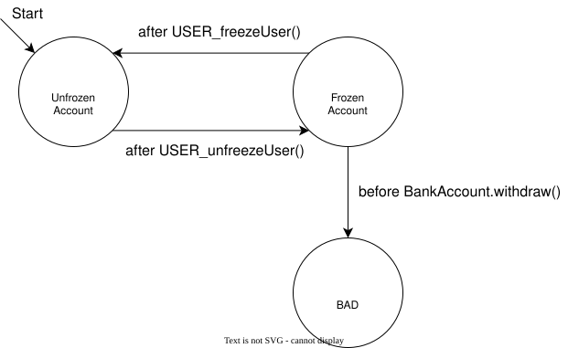

# CPS3233 Assignment Part A
## Julian David Cassar

https://github.com/jdc-asdf/CPS3233

<div style="page-break-before: always;"></div>

## The Property

> Once a user freezes their profile, none of their money accounts may be withdrawn from until they unfreeze it.

Based on the information given in Section 3.1 Usermode:
"frozen users may not perform money transfers"

## The Formalism

<p align="center">
  
</p>

The property was formalised using an Automaton. An automaton was chosen because the property defines an order of events that should occur. The order in this case is: if a profile goes from unfrozen to frozen it then may not have withdraws on its accounts, but if it is unfrozen then it can allow withdraws again. The account can be represented as states in the automaton while the freezing/unfreezing and withdrawl can be represented as transitions in the automaton.

However while an automaton fits the property quite well it can also be represented by a regular expression, the only drawback being that the expression would be quite complex. 

## The Monitor (Results)

```
Running scenario 1.
This scenario should violate property 1.
Withdrawal while frozen

Running scenario 2.
This scenario should not violate property 1.
```

Scenario 1:
Freeze the profile and then make an external payment of 10. The resulting withdrawal occurs while frozen, the monitor returns BAD.

Scenario 2:
Freeze and Unfreeze the profile and make an external payment of 10. The resulting withdrawal occurs while not frozen so not violation occurs.

The results match the expected outcome.

## Trace Sets
The property should accept any trace where a freeze is followed by an unfreeze before any withdrawl occurs and a withdraw before any freeze occurs.

Some examples:
```
REJECTED:
freeze() -> withdrawl() 
freeze() -> unfreeze() -> freeze() -> withdrawl() 
```

```
ACCEPTED:
freeze() -> unfreeze() -> withdraw() 
freeze() -> unfreeze() -> withdraw() -> freeze() 
freeze() -> unfreeze() -> withdraw() -> freeze() -> unfreeze() -> withdraw()
freeze() -> unfreeze() -> freeze() -> unfreeze() -> withdraw() 
withdraw()
withdraw() -> withdraw() -> withdraw()
freeze() 
```

## Correctness
The automaton tracks whether a freeze has occurred without a subsequent successful unfreeze. A withdrawal in this state leads to BAD, otherwise, it is permitted. The monitor checks withdrawls generally, which covers any transfer method on the frontend.

## Iteration History

Initially considered the property to be "Once a user freezes their profile, their account may not be debited and credited", (i.e. no money goes in or out of the account) but the wording of appendix seems to  point towards the user themsevles **performing* a transfer not someone else sending them money, so only withdraws were considered.

Changed from checking the front end for freezes to checking user info. This is more appropriate place to check as if freezing is extended to be done through other features it would require the monitor to be modified.

The initial monitor used one global automaton state, which could flag one user’s freeze or unfreeze events with another user’s withdrawals. This was changed to a paramterised automaton to fix this issue.

## Subtleties
The property written in english translated quite well to the formalisation, there were no ambiguities to be considered. 

## AI account
AI assistance helped develop the property, explain the automaton notation, and troubleshoot compilation errors (For compiling MyRVTool). Its initial proposal used a global state that could mix events from different users; this was corrected using parameterised automata.